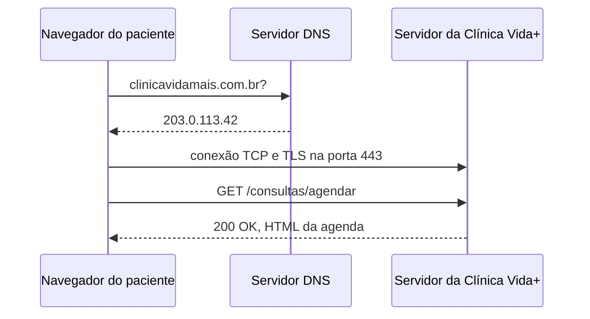

## O caminho de uma requisição


```mermaid
C:\Users\User>nslookup uninove.br 8.8.8.8
Servidor:  dns.google
Address:  8.8.8.8

Não é resposta autoritativa:
Nome:    uninove.br
Address:  167.99.0.217
```
```mermaid
css2?family=Raleway:ital
method: get
status 200 OK

ccde9ef.js
method: get
status: 200 OK

gtm.js
method: get
status: 304 Not Modified

ef85d6d.js
method: get
status: 200 OK
```
# formulário de agendamento da Clínica Vida+ vai precisar do https para garantir a privacidade do paciente e médico ,como o cpf do paciente. Já que o mesmo possui uma cipritografia que impede essas informações de serem adulteradas ou interceptadas.