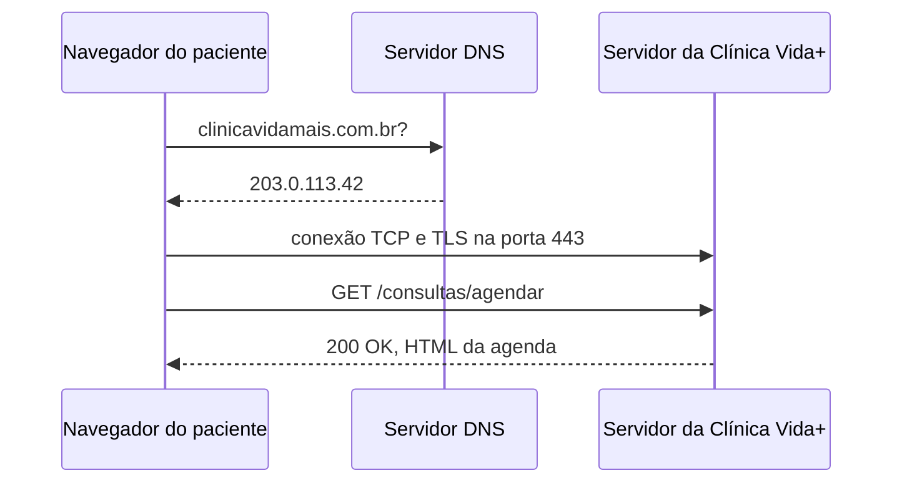

## O caminho de uma requisição

## O caminho de uma requisição

## Evidência do DNS

Servidor:  UnKnown
Address:  2804:868:3:cd17:143:255:225:200

Não é resposta autoritativa:
Nome:    github.com
Address:  4.228.31.150

## Evidência do HTTP

| # | Recurso / Caminho | Método | Status | Tipo (`Content-Type`) |
|---|---|---|---|---|
| 1 | `/` (página inicial do `github.com`) | `GET` | `200` | `text/html; charset=utf-8` |
| 2 | `/assets/primer.css` | `GET` | `200` | `text/css` |
| 3 | `/assets/wp-runtime.js` | `GET` | `200` | `text/javascript` |
| 4 | `/favicons/favicon.svg` | `GET` | `200` | `image/svg+xml` |

Para proteger dados sensiveis e passar segurança aos pacientes 